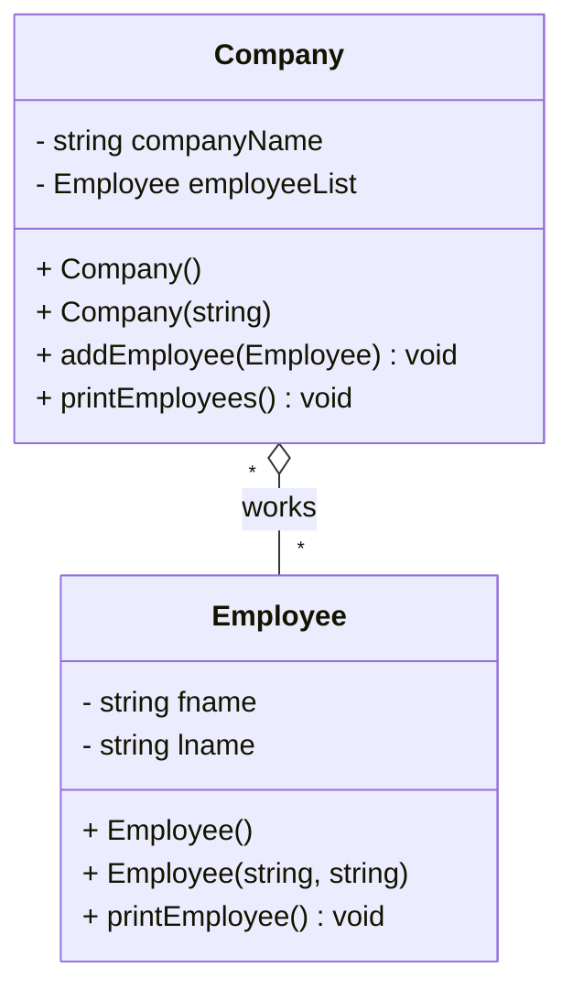
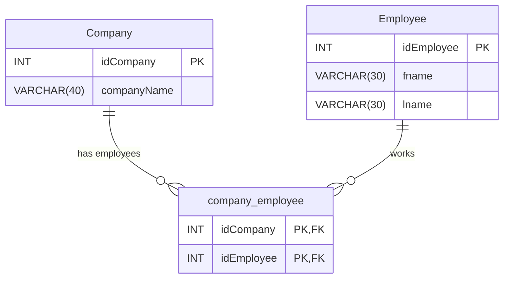

# H4 Agregaatio tehtävän luokkadiagrammi

## Tietokanta

Jos tämän sovelluksen tapainen data pitäisi tallentaa
relaatiotietokantaan, niin ratkaisu olisi tällainen:

- Employee ja Company taulujen välillä yhteys monen suhde moneen. Tarvitaa
siis välitystaulu.

### ER-Kaavio

